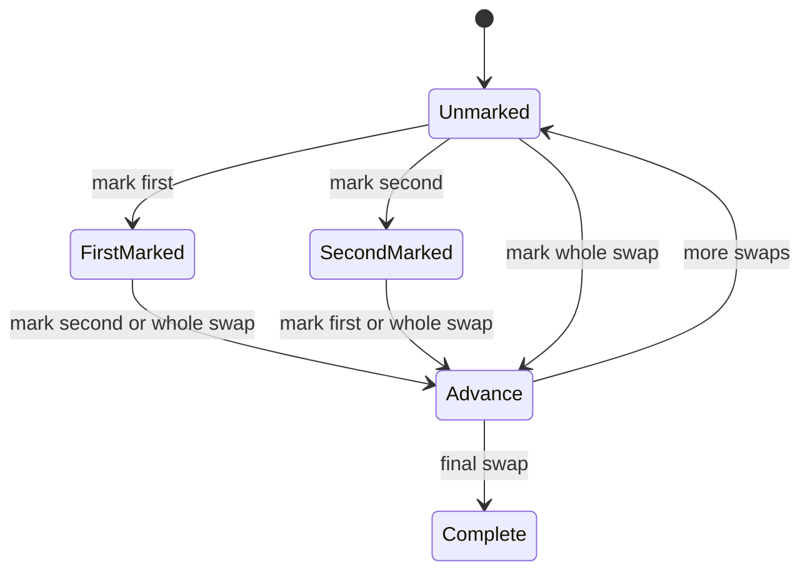

# App state machines

This inventory covers the application-owned state in `src/`: React state,
effects and event handlers, derived result branches, the pre-paint theme script,
URL navigation, and native disclosures. It excludes build/CI workflows and
library internals. A machine can have independent dimensions; enumerating their
entire Cartesian product would obscure the rules.

## Design decision

Use typed events and pure reducers for coupled tool state, following the
existing practice reducer. React renders the current state and dispatches
events; puzzle rules stay in their existing modules. Validate transitions
against the latest state as well as disabling unavailable controls. This
prevents queued clicks from creating duplicate observations or placing a marker
for a previously selected role.

Keep results derived from inputs, with no second stored status to synchronize.
Keep hydration, browser navigation, native disclosures and theme side effects in
their existing owners. No state-machine dependency, global store, persistence,
new UI mode, or external agent API is needed.

## Inventory

### Dissection inputs

Owner: [`calculator.ts`](../src/lib/calculator.ts),
[`Calculator.tsx`](../src/components/Calculator.tsx).

States: Two optional inside symbols and two optional outside solids.

`inside`, `outside`, `reset-inside`, `reset-outside`, `reset`. Inside symbols
must differ; identical outside solids are allowed. Scoped resets preserve the
other group.

Tests: `calculator.test.ts`, `Calculator.test.tsx`, `tools.spec.ts`.

### Dissection result

Owner: `Calculator.tsx` / `verity.ts`.

States: Needs inside → needs outside → invalid / solved / sequence.

Derived by `inferInside`, `inferOutside`, `solve`. Input edits can move back to
any earlier state. Invalid solids remain editable. Only explicit result/edit
links scroll.

Tests: `verity.test.ts`, `Calculator.test.tsx`, `usability.spec.ts`.

### Manual checklist

Owner: [`sequence.ts`](../src/lib/sequence.ts),
[`Sequence.tsx`](../src/components/Sequence.tsx).

States: Current swap unmarked / first marked / second marked; all swaps marked;
undo history.

`mark` and `undo`. Either cut may be first. Only the current swap accepts marks;
repeated and out-of-range marks do nothing. Completing both cuts advances once.
Undo restores the exact previous partial state.

Tests: `sequence.test.ts`, `Calculator.test.tsx`, `dissection-progress.spec.ts`.

### Solo observation

Owner: [`solo.ts`](../src/lib/solo.ts),
[`SoloCalculator.tsx`](../src/components/SoloCalculator.tsx).

States: Opening / after-opening stage, optional inside symbols, identity and
room shapes.

`inside`, `self`, `room-shape`, `phase`, scoped resets and `reset`. Distinct
inside symbols; identity requires known symbols. A real stage change clears room
shapes and preserves statues. Repeating the current stage preserves
observations.

Tests: `solo-state.test.ts`, `SoloCalculator.test.tsx`, `solo-stages.spec.ts`.

### Solo result

Owner: `SoloCalculator.tsx` / `verity.ts`.

States: Needs symbols / identity / room shapes; invalid or coordination needed;
transfer plan; finished pair.

Derived by `planSoloTransfers` or `planSoloAfterTrades`. No transfers to self or
a statue holding that shape. The stage is a player declaration, not verified
teammate progress.

Tests: `solo.test.ts`, `SoloCalculator.test.tsx`, `solo-stages.spec.ts`.

### Repository observations

Owner: [`repository.ts`](../src/lib/repository.ts),
[`RepositoryHelper.tsx`](../src/components/RepositoryHelper.tsx).

States: Partial / complete route; zero / one / two callouts; optional held
resonance.

`start`, `room`, `callout`, `held`, `reset`. Callouts and resonance require a
route. At most two distinct explicit callouts; the third stays inferred. A new
room clears callouts and resonance atomically.

Tests: `repository.test.ts`, `RepositoryHelper.test.tsx`, `repository.spec.ts`.

### Repository guidance

Owner: `RepositoryHelper.tsx` / `repository.ts`.

States: Receive: needs route / destination. Close: needs route / observations /
stay / move.

Derived by `getEndPlate`, `inferConductors`, `getClosureTarget`. Receiving and
closing have separate sender reminders. The latest held resonance determines the
closing destination.

Tests: `repository.test.ts`, `RepositoryHelper.test.tsx`, `repository.spec.ts`.

### Map editing

Owner: [`substratum.ts`](../src/lib/substratum.ts),
[`SubstratumMap.tsx`](../src/components/SubstratumMap.tsx).

States: Selected role × five unset/placed markers.

`select`, `place` (including `null` to clear), `reset`. Placement uses the
latest selected role. Four endpoints occupy distinct outer rooms; You may share
any room. Clear preserves other roles; reset also selects You.

Tests: `substratum.test.ts`, `SubstratumMap.test.tsx`, `substratum.spec.ts`.

### Exercise lifecycle and cut transaction

Owner: [`practice.ts`](../src/lib/practice.ts),
[`Exercise.tsx`](../src/components/Exercise.tsx).

States: Ready / running / won / expired; running has no cut / one pending cut;
timed / untimed.

`start`, `retry`, `tick`, `excise`, `cancel`. Two legal cuts exchange shapes
once. Each excision checks wall time before applying the cut. Won/expired rounds
reject cuts. Retry restores the retained starting puzzle.

Tests: `practice.test.ts`, `Exercise.test.tsx`, `retry-exercise.spec.ts`,
`untimed.spec.ts`.

### Exercise controls

Owner: same reducer.

States: Current shape; selected next-round mode independent of active mode.

`select-shape`, `select-mode`. Mode changes preserve the active puzzle, pending
cut and deadline. Start/retry apply the selected mode and reset shape, clock,
cuts and swaps in one transition.

Tests: `practice.test.ts`, `Exercise.test.tsx`, `retry-exercise.spec.ts`,
`untimed.spec.ts`.

### Control readiness

Owner: [`useHydrated.ts`](../src/components/useHydrated.ts),
`ToolReadiness.tsx`, `ShapePicker.tsx`.

States: Server-rendered/disabled → hydrated/enabled; domain guards can keep
individual controls disabled.

React mount enables handlers; unmount/reload starts over. `CONTROL_PROPS`
prevents Firefox restoring enabled state too early. Theme has its own readiness
gate after preference synchronization.

Tests: `RepositoryHelper.test.tsx`, `tools.spec.ts`, `usability.spec.ts`.

### Theme

Owner: [`theme.ts`](../src/lib/theme.ts), `ThemeSelect.tsx`, `Layout.astro`.

States: Preference light / dark / system; resolved light / dark; initializing /
ready.

Pre-paint script, mount, user selection, system media changes, cross-tab storage
events. Invalid/unavailable storage falls back to system; a user selection still
applies if saving fails. Media changes follow the current in-memory preference.
Listeners are removed on unmount.

Tests: `ThemeSelect.test.tsx`, `theme.spec.ts`.

### Route, locale and section navigation

Owner: [`navigation.ts`](../src/lib/navigation.ts), `ToolPage.astro`,
`SiteHeader.tsx`.

States: Six pages × English/Chinese; optional result/input fragment.

Astro links preserve locale or page as appropriate and respect `BASE_PATH`.
Full-page navigation clears tool state; fragment links retain inputs. Theme
survives when storage is available.

Tests: `SiteHeader.test.tsx`, `tools.spec.ts`, `usability.spec.ts`, both
deployment-path suites.

### Native references and control focus

Owner: `RepositoryHelper.tsx`, `SubstratumMap.tsx`, Radix controls.

States: Reference closed/open; focused choice and checked choice.

Browser `
` toggles preserve tool state. Radix owns
keyboard/roving-focus behavior; reducers own checked values. Keep these
native/accessible behaviors rather than duplicating them in application state.

Tests: `ShapePicker.test.tsx`, `responsive.spec.ts`, `substratum.spec.ts`,
`repository.spec.ts`.

## Reset and lifetime boundaries

- **Dissection inside/outside reset**: clears that input group and checklist
  history; preserves other input group.
- **Any changed dissection puzzle input**: clears checklist history; preserves
  other puzzle inputs.
- **Solo inside reset**: clears inside symbols and own statue; preserves room
  shapes and trade stage.
- **Solo room reset**: clears room shapes; preserves statues and trade stage.
- **Solo stage change**: clears room shapes; preserves statues.
- **Repository room change**: clears callouts and held resonance; preserves
  assigned start plate.
- **Repository start change**: clears nothing else; preserves room, callouts and
  held resonance.
- **Map clear**: clears selected marker; preserves selection and other markers.
- **Map reset**: clears all markers; selection returns to You; preserves nothing
  from the previous map.
- **Exercise next-mode change**: clears nothing active; preserves puzzle, cut,
  swaps, active mode, deadline and current shape.
- **Exercise retry**: clears swaps, pending cut and current shape; fresh clock;
  preserves retained puzzle and selected next-round mode.
- **Exercise new round**: clears previous round and retained puzzle; preserves
  selected next-round mode.
- **Full tool reset / reload / page or language navigation**: clears tool state;
  solo returns to opening; preserves stored theme preference, when available.

The dissection checklist is a child machine scoped by
`key={JSON.stringify([inside, outside])}`. A changed valid puzzle remounts it;
incomplete, invalid and solved results unmount it. Keep this boundary when
changing result rendering. Do not key by swap count: different puzzles can have
the same number of swaps.

## Checklist transition model

Each accepted mark saves a snapshot. `undo` restores that snapshot, including
from Complete; rejected marks save nothing. Marks record the player's checklist
and never prove the live encounter is solved.

## Contributor verification

Reducers accept exported discriminated action types and immutable state and can
be exercised directly without React, a browser, a clock mock or random puzzles.
Time and generated puzzles are passed into the exercise reducer as event data.
Derived results reuse domain functions rather than maintaining parallel status
flags. No reducer reads the DOM, storage or network.

Tests cover queued UI events, invalid transition attempts, scoped resets,
partial Undo, stage/room boundaries and next-round settings. Existing domain
tests cover the valid puzzle layouts and transfer/wiring permutations.
Production Playwright tests remain necessary for hydration, accessibility,
keyboard/touch behavior, themes, both locales and root/subdirectory deployments.

Run `npm run check`, `npm run lint`, `npm run format`, and `npm test` for state
changes, then the relevant production browser journeys. For changes spanning all
tools, use `npm run test:e2e:all` sequentially in the same workspace. These
checks reduce regression risk; they do not establish behavior of the live game
or every possible browser scheduling order.
